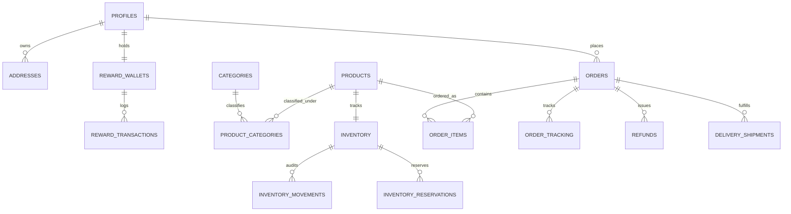

# LUNA Database Architecture & Schema Documentation

---

## 1. Overview & Technology

The LUNA persistence layer is built on **Supabase PostgreSQL 15+**, taking full advantage of:
- Relational integrity with strict foreign key constraints and `ON DELETE` cascade/restrict rules.
- Column-level validation checks (e.g., non-negative pricing and non-negative stock counts).
- **Row-Level Security (RLS)** for multi-tenant customer isolation and administrative privilege enforcement.
- Automated `updated_at` timestamps managed by PostgreSQL triggers.
- Specialized indices for fast full-text searching, slug resolution, and geospatial queries.

---

## 2. Migration Files Overview

Database state is governed by sequential migration scripts located in `supabase/migrations/`:

| Migration File | Primary Responsibility |
| :--- | :--- |
| `01_auth_and_profiles.sql` | `profiles`, `addresses`, `user_roles` trigger on `auth.users`, initial RLS policies |
| `02_seed_demo_data.sql` | Initial demo categories and baseline curated product records |
| `03_products_categories_inventory.sql` | `categories`, `products`, `product_categories`, `inventory`, `inventory_movements`, `inventory_reservations`, and stock stored procedures |
| `04_orders_payments_and_refunds.sql` | `orders`, `order_items`, `order_tracking`, `refunds`, and Razorpay integration schema |
| `05_loyalty_rewards_and_delivery_shipments.sql` | `reward_settings`, `reward_wallets`, `reward_transactions`, and `delivery_shipments` |

---

## 3. Entity Relationship Diagram (ERD)



---

## 4. Complete Table Specifications

### 4.1 `profiles`
Stores extended customer and administrative account attributes linked directly to Supabase Auth (`auth.users.id`).

| Column | Type | Constraints | Description |
| :--- | :--- | :--- | :--- |
| `id` | `UUID` | `PRIMARY KEY, REFERENCES auth.users(id) ON DELETE CASCADE` | Supabase Auth user ID |
| `email` | `VARCHAR(255)` | `NOT NULL, UNIQUE` | Customer email address |
| `role` | `VARCHAR(50)` | `NOT NULL DEFAULT 'customer'` | Role: `'customer'` or `'admin'` |
| `first_name` | `VARCHAR(100)` | `NULLABLE` | Customer first name |
| `last_name` | `VARCHAR(100)` | `NULLABLE` | Customer last name |
| `mobile_number`| `VARCHAR(20)` | `NULLABLE` | Contact phone number |
| `created_at` | `TIMESTAMPTZ` | `NOT NULL DEFAULT NOW()` | Record creation timestamp |
| `updated_at` | `TIMESTAMPTZ` | `NOT NULL DEFAULT NOW()` | Record modification timestamp |

### 4.2 `addresses`
Customer shipping and billing addresses with Indian PIN and mobile verification.

| Column | Type | Constraints | Description |
| :--- | :--- | :--- | :--- |
| `id` | `UUID` | `PRIMARY KEY DEFAULT gen_random_uuid()` | Address identifier |
| `user_id` | `UUID` | `NOT NULL, REFERENCES profiles(id) ON DELETE CASCADE` | Owner profile ID |
| `full_name` | `VARCHAR(255)` | `NOT NULL` | Recipient full name |
| `mobile_number`| `VARCHAR(20)` | `NOT NULL` | Recipient phone number (+91) |
| `address_line1`| `TEXT` | `NOT NULL` | House/flat number, building |
| `address_line2`| `TEXT` | `NULLABLE` | Street, area, landmark |
| `city` | `VARCHAR(100)` | `NOT NULL` | City name |
| `district` | `VARCHAR(100)` | `NOT NULL` | District |
| `state` | `VARCHAR(100)` | `NOT NULL` | State name |
| `pin_code` | `VARCHAR(10)` | `NOT NULL` | 6-digit Indian PIN code |
| `latitude` | `DECIMAL(10,8)`| `NULLABLE` | Geocoded latitude |
| `longitude` | `DECIMAL(11,8)`| `NULLABLE` | Geocoded longitude |
| `is_default` | `BOOLEAN` | `DEFAULT FALSE` | Default checkout address flag |

### 4.3 `categories`
Hierarchical catalog classification.

| Column | Type | Constraints | Description |
| :--- | :--- | :--- | :--- |
| `id` | `UUID` | `PRIMARY KEY DEFAULT gen_random_uuid()` | Category ID |
| `name` | `VARCHAR(100)` | `NOT NULL` | Category display title |
| `slug` | `VARCHAR(120)` | `NOT NULL, UNIQUE` | URL-friendly unique slug |
| `description` | `TEXT` | `NULLABLE` | Marketing description |
| `image_url` | `TEXT` | `NULLABLE` | Supabase storage image URL |
| `display_order`| `INT` | `DEFAULT 0` | Ordering index on storefront |
| `is_active` | `BOOLEAN` | `DEFAULT TRUE` | Visibility toggle |

### 4.4 `products`
Master product catalog records.

| Column | Type | Constraints | Description |
| :--- | :--- | :--- | :--- |
| `id` | `UUID` | `PRIMARY KEY DEFAULT gen_random_uuid()` | Product ID |
| `title` | `VARCHAR(255)` | `NOT NULL` | Product title |
| `slug` | `VARCHAR(280)` | `NOT NULL, UNIQUE` | Unique SEO slug |
| `description` | `TEXT` | `NOT NULL` | Long-form description |
| `price` | `NUMERIC(10,2)`| `NOT NULL, CHECK (price >= 0)` | Base retail price |
| `sale_price` | `NUMERIC(10,2)`| `NULLABLE, CHECK (sale_price >= 0)` | Promotional discounted price |
| `sku` | `VARCHAR(100)` | `NOT NULL, UNIQUE` | Stock Keeping Unit |
| `primary_image`| `TEXT` | `NULLABLE` | Primary image URL |
| `images` | `JSONB` | `DEFAULT '[]'::jsonb` | Array of additional image URLs |
| `is_active` | `BOOLEAN` | `DEFAULT TRUE` | Catalog visibility status |
| `created_at` | `TIMESTAMPTZ` | `NOT NULL DEFAULT NOW()` | Product creation timestamp |

### 4.5 `inventory`
Real-time stock ledger for each product.

| Column | Type | Constraints | Description |
| :--- | :--- | :--- | :--- |
| `product_id` | `UUID` | `PRIMARY KEY, REFERENCES products(id) ON DELETE CASCADE` | Product reference |
| `available_quantity`| `INT`| `NOT NULL DEFAULT 0, CHECK (available_quantity >= 0)` | Available stock |
| `reserved_quantity` | `INT`| `NOT NULL DEFAULT 0, CHECK (reserved_quantity >= 0)` | Locked checkout stock |
| `low_stock_threshold`| `INT`| `NOT NULL DEFAULT 5` | Low stock alert trigger |
| `updated_at` | `TIMESTAMPTZ`| `NOT NULL DEFAULT NOW()` | Last inventory update |

### 4.6 `inventory_movements`
Permanent audit trail for all stock fluctuations.

| Column | Type | Constraints | Description |
| :--- | :--- | :--- | :--- |
| `id` | `UUID` | `PRIMARY KEY DEFAULT gen_random_uuid()` | Movement event ID |
| `product_id` | `UUID` | `NOT NULL, REFERENCES products(id) ON DELETE CASCADE` | Product reference |
| `previous_quantity`| `INT` | `NOT NULL` | Quantity prior to change |
| `quantity_changed` | `INT` | `NOT NULL` | Delta (+ or -) |
| `new_quantity` | `INT` | `NOT NULL` | Quantity after change |
| `movement_type`| `VARCHAR(50)`| `NOT NULL` | `restock`, `order_deduction`, `reservation_release`, `damage` |
| `reason` | `TEXT` | `NULLABLE` | Operational reason |
| `admin_id` | `UUID` | `NULLABLE, REFERENCES profiles(id)` | Admin actor (if manual) |
| `created_at` | `TIMESTAMPTZ`| `NOT NULL DEFAULT NOW()` | Event timestamp |

### 4.7 `orders` & `order_items`
Core transactional records.

| Column | Type | Constraints | Description |
| :--- | :--- | :--- | :--- |
| `id` | `UUID` | `PRIMARY KEY DEFAULT gen_random_uuid()` | Order ID |
| `user_id` | `UUID` | `NOT NULL, REFERENCES profiles(id)` | Customer ID |
| `status` | `VARCHAR(50)` | `NOT NULL DEFAULT 'NEW'` | `NEW`, `CONFIRMED`, `PACKED`, `DISPATCHED`, `DELIVERED`, `CANCELLED`, `REJECTED` |
| `subtotal` | `NUMERIC(10,2)`| `NOT NULL` | Undiscounted items total |
| `delivery_charges`| `NUMERIC(10,2)`| `NOT NULL DEFAULT 0.00` | Shipping fee |
| `discount_amount` | `NUMERIC(10,2)`| `NOT NULL DEFAULT 0.00` | Promo discount |
| `coins_redeemed` | `INT` | `NOT NULL DEFAULT 0` | Loyalty coins applied |
| `coins_discount` | `NUMERIC(10,2)`| `NOT NULL DEFAULT 0.00` | Rupee value of coins |
| `total_amount` | `NUMERIC(10,2)`| `NOT NULL` | Final payable amount |
| `payment_status` | `VARCHAR(50)` | `NOT NULL DEFAULT 'PENDING'` | `PENDING`, `PAID`, `FAILED`, `REFUNDED` |
| `payment_method` | `VARCHAR(50)` | `NOT NULL` | `RAZORPAY`, `COINS_ONLY`, `MIXED` |
| `razorpay_order_id`| `VARCHAR(255)`| `NULLABLE` | Razorpay order ID |
| `razorpay_payment_id`| `VARCHAR(255)`| `NULLABLE` | Razorpay payment ID |
| `delivery_method`| `VARCHAR(50)` | `NOT NULL` | `HOME_DELIVERY` or `STORE_PICKUP` |

### 4.8 `reward_wallets` & `reward_transactions`
Loyalty points ledger.

| Column | Type | Constraints | Description |
| :--- | :--- | :--- | :--- |
| `user_id` | `UUID` | `PRIMARY KEY, REFERENCES profiles(id) ON DELETE CASCADE` | Customer wallet owner |
| `balance` | `INT` | `NOT NULL DEFAULT 0, CHECK (balance >= 0)` | Available coins |
| `total_earned` | `INT` | `NOT NULL DEFAULT 0` | Lifetime earned coins |
| `total_redeemed` | `INT` | `NOT NULL DEFAULT 0` | Lifetime redeemed coins |

---

## 5. Row-Level Security (RLS) Policies

All tables have RLS enabled (`ALTER TABLE ... ENABLE ROW LEVEL SECURITY`). Examples:

```sql
-- Customers can only read and update their own profile
CREATE POLICY "Users can view own profile"
  ON profiles FOR SELECT
  USING (auth.uid() = id);

-- Admins can view and manage all profiles
CREATE POLICY "Admins full access to profiles"
  ON profiles FOR ALL
  USING (
    EXISTS (SELECT 1 FROM profiles WHERE id = auth.uid() AND role = 'admin')
  );

-- Customers can view their own orders
CREATE POLICY "Users view own orders"
  ON orders FOR SELECT
  USING (auth.uid() = user_id);

-- Public can read active categories and products
CREATE POLICY "Public read active categories"
  ON categories FOR SELECT
  USING (is_active = TRUE);

CREATE POLICY "Public read active products"
  ON products FOR SELECT
  USING (is_active = TRUE);
```
