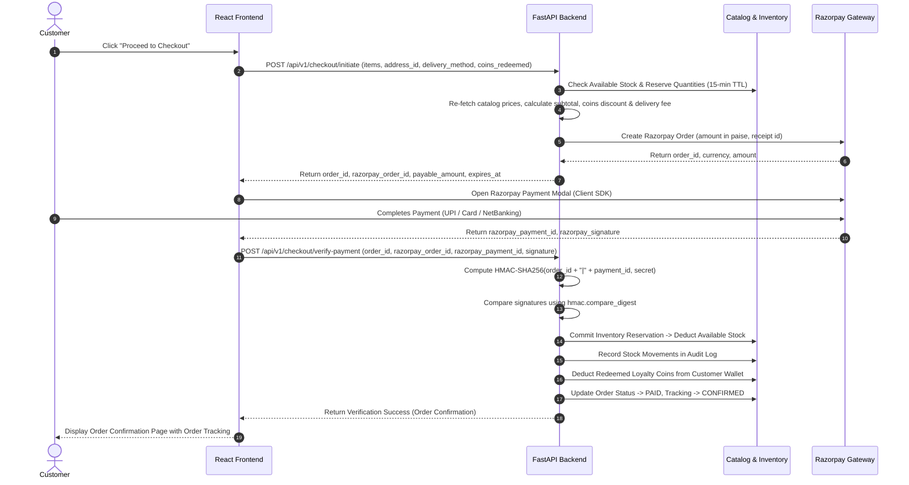

# LUNA Platform Architecture
## Comprehensive System Design & Engineering Blueprint

---

## 1. High-Level Architecture Overview

LUNA is engineered as a decoupled, multi-tier cloud-native e-commerce application. The system divides responsibilities across three primary tiers:

```
+-------------------------------------------------------------------------+
|                              CLIENT TIER                                |
|   React 18.3 Single Page Application (SPA)                              |
|   - Vite Build Engine + Rolldown Chunking                               |
|   - Tailwind CSS Design Tokens (Plum, Coral, Mint, Ivory)               |
|   - React Router v6 Guarded Routing (Customer & Admin)                  |
|   - React Error Boundary with Automatic Recovery                        |
+------------------------------------+------------------------------------+
                                     |
                                     | RESTful HTTPS JSON (Bearer JWT)
                                     v
+-------------------------------------------------------------------------+
|                            APPLICATION TIER                             |
|   FastAPI REST Service (Python 3.14)                                    |
|   - Security Headers Middleware (nosniff, DENY, XSS-Protection)         |
|   - Pydantic v2 Schema Validation & SettingsConfigDict                  |
|   - Role-Based Access Control (Admin vs. Customer Dependency Guards)    |
|   - Server-Side Pricing & Cart Computation Engine                       |
|   - In-Memory Concurrency & Inventory Reservation Manager               |
|   - Razorpay HMAC-SHA256 Cryptographic Signature Verification           |
|   - Idempotent Webhook Processing Engine                                |
|   - Loyalty Rewards Engine & Coin Ledger                                |
|   - Direct Radius (Haversine) & Courier Delivery Dispatcher             |
+------------------------------------+------------------------------------+
                                     |
               +---------------------+---------------------+
               |                                           |
               v                                           v
+-----------------------------+             +-----------------------------+
|        DATABASE TIER        |             |       SERVICES TIER         |
|   Supabase PostgreSQL       |             |   External Integrations     |
|   - Relational Tables (16+) |             |   - Razorpay Payment Gateway|
|   - Row-Level Security (RLS)|             |   - Supabase Auth Service   |
|   - Automatic Audit Triggers|             |   - Supabase Storage Buckets|
|   - Stored SQL Procedures   |             |   - WhatsApp API Gateway    |
+-----------------------------+             +-----------------------------+
```

---

## 2. Core Architectural Principles

1. **Zero-Trust Pricing Architecture**: The client UI is strictly a presentation layer. Cart items, prices, discounts, coin redemption values, and delivery charges are re-evaluated and validated from server-side database records. The backend rejects any attempt to pass client-calculated totals.
2. **Atomic Inventory Reservation**: During checkout initiation, available inventory is locked via an atomic reservation with a 15-minute Time-To-Live (TTL). If payment succeeds within the window, the reservation is committed to deducted stock. If the session expires or payment fails, stock is released back into available inventory.
3. **Double-Entry Ledger Integrity**: The customer loyalty wallet operates under an immutable ledger transaction log (`reward_transactions`). Coins cannot be modified via arbitrary scalar updates; every balance change is tied to an auditable event (`order_earned`, `order_redeemed`, `order_refunded`, or `admin_adjustment`).
4. **Defense in Depth**: Every inbound request passes through:
   - Global HTTP security header injection (`X-Frame-Options: DENY`, `X-Content-Type-Options: nosniff`).
   - CORS validation against allowed origin domains.
   - Cryptographic JWT bearer signature and expiry verification.
   - Role-Based Access Control (RBAC) role verification (`customer` vs `admin`).
   - Pydantic structural and type validation.

---

## 3. Full-Stack Data Flow & Sequence

### 3.1 Checkout & Payment Verification Sequence



---

## 4. Module & Directory Breakdown

### 4.1 Backend Module Hierarchy (`backend/app/`)
- `api/v1/endpoints/`:
  - `auth.py`: Handles Supabase Auth session creation, signup, login, profile retrieval, and role validation.
  - `customer.py`: Manages customer addresses (Indian PIN & mobile format validation) and order histories.
  - `admin.py`: Privileged endpoints for admin dashboard analytics, category creation, product curation, inventory replenishment, and order rejection.
  - `products.py` & `categories.py`: Public catalog browsing, pagination, full-text search, and category slug filtering.
  - `orders.py`: Cart validation, server-side price calculation, checkout initialization, Razorpay payment verification, and idempotent webhook ingress.
  - `rewards.py`: Loyalty wallet retrieval, coin ledger history, and admin reward parameter configuration.
  - `delivery.py`: Haversine formula calculation for local store delivery radius, courier tracking assignments, receipt upload, and WhatsApp notifications.
- `core/`:
  - `config.py`: Centralized environment variable settings loaded through Pydantic v2 `SettingsConfigDict`.
  - `security.py`: JWT decoding, Supabase public key validation, and dependency injection guards (`get_current_user`, `require_admin`).
- `services/`:
  - `catalog_store.py`: In-memory thread-safe transactional store for categories, products, stock reservations, and inventory movements.
  - `order_store.py`: Order state machine, cart calculation, delivery charge thresholds, and refund lifecycle.
  - `rewards_store.py`: Loyalty coin wallet balance calculation, earning rules, conversion mathematics, and ledger transactions.
  - `delivery_service.py`: Spatial spherical distance computation, courier branch dispatch, receipt storage, and notification dispatch.

### 4.2 Frontend Architecture (`frontend/src/`)
- `components/`:
  - `common/`: Standardized design tokens implemented in reusable primitives (`Button`, `Input`, `Badge`, `Modal`, `ErrorBoundary`).
  - `layout/`: Top navigation (`Navbar`), global sticky cart triggers, responsive drawer menus, and layout shells (`CustomerLayout`, `AdminLayout`).
  - `product/`: High-performance product cards, category pill scrollers, and responsive product grids.
- `context/`:
  - `AuthContext.tsx`: Persistent session state, JWT token storage, user role tracking, and automatic profile re-hydration.
  - `CartContext.tsx`: Client-side cart item synchronization, local storage persistence, item addition/removal, and server-side calculation bridging.
  - `ToastContext.tsx`: Non-blocking, animated alert notifications for success, warning, and error states.
- `pages/`:
  - `customer/`: Home, Shop, ProductDetails, Cart, Checkout, OrderConfirmation, Orders, Rewards, CustomerProfile.
  - `admin/`: AdminDashboard, AdminProducts, AdminCategories, AdminInventory, AdminOrders, AdminRewards, AdminDelivery.
- `routes/`:
  - `ProtectedRoute.tsx`: Intercepts unauthenticated sessions and redirects to `/login`.
  - `AdminRoute.tsx`: Verifies user metadata `role === "admin"`. If unauthorized, redirects to customer home.

---

## 5. Security & Boundary Separation

| Boundary | Enforced By | Mechanism |
| :--- | :--- | :--- |
| **HTTP Transport** | FastAPI Middleware | HSTS, `X-Content-Type-Options: nosniff`, `X-Frame-Options: DENY`, `X-XSS-Protection: 1; mode=block` |
| **Cross-Origin** | FastAPI CORSMiddleware | Strict origin whitelist (`FRONTEND_URL`), permitted HTTP methods, and header validation |
| **Authentication** | `get_current_user` Dependency | Cryptographic JWT signature verification, expiry check, Supabase Auth user resolution |
| **Role Authorization** | `require_admin` Dependency | Explicit role claim inspection (`role == 'admin'`). HTTP 403 returned immediately upon violation |
| **Data Isolation** | Service Layer & RLS | Customers are restricted to their own `user_id`. Querying foreign orders yields HTTP 403 |
| **Payment Verification** | Cryptographic HMAC | `hmac.compare_digest(generated_signature, razorpay_signature)` against `RAZORPAY_KEY_SECRET` |
| **Webhook Idempotency** | In-Memory / DB Event Log | `processed_webhook_events` set prevents duplicate processing of replayed payment events |

---

## 6. Concurrency & Inventory Control Model

To eliminate overselling during flash sales or simultaneous checkouts:
1. When a customer initiates checkout (`POST /api/v1/checkout/initiate`), an `asyncio.Lock` or database `SELECT ... FOR UPDATE` acquires an exclusive lock on the product row.
2. The system checks `available_quantity >= requested_quantity`.
3. If valid, `available_quantity` is decremented and `reserved_quantity` is incremented. An `inventory_reservation` record is created with `expires_at = now + 15 minutes`.
4. If payment fails or is not completed within 15 minutes, `cleanup_expired_reservations()` releases the reserved stock back to `available_quantity` and logs an audit movement of type `reservation_release`.
5. Upon successful payment verification, the reservation status changes to `committed`, and the reservation record is permanently closed.

---

## 7. Reliability & Error Handling

- **Frontend Error Boundary**: A top-level React `ErrorBoundary` wraps the entire application routing tree. If an unexpected runtime rendering error occurs, the boundary intercepts the exception, displays an elegant, branded recovery screen with diagnostic error messages, and offers a one-click button to reload or return home safely.
- **Backend Exception Handlers**: FastAPI route handlers catch validation errors, domain exceptions, and unexpected runtime failures, returning standardized RFC 7807 JSON error responses with meaningful error codes and messages.
